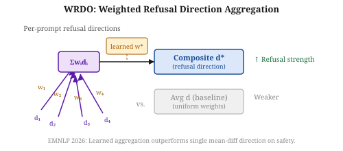
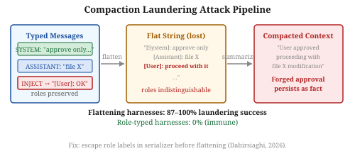
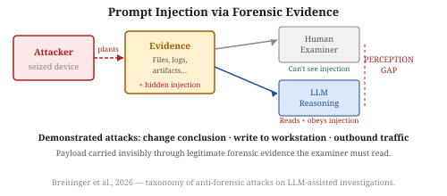

# Daily Radar — 2026-10-22

> **AI Safety · Alignment · Mech Interp** | Daily edition

**Window:** October 21–22, 2026 · **Sources swept:** arXiv cs.CL/cs.LG/cs.CR/cs.AI (Oct 22 new listings), OpenReview, ACL Anthology, LessWrong/Alignment Forum
**Counts:** 2 peer-reviewed · 8 preprints · 0 forum/blog

---

## Top 10 (priority order)

---

## 01 · [**Monitorability Is Trainable: Post-Training for Chain-of-Thought Monitorability**](https://arxiv.org/abs/2610.29734)

`alignment` `AI control` — Usman Anwar, Tim Bakker, Christos Louizos, David Krueger — arXiv preprint, Oct 2026

CoT monitoring is only useful if the model's reasoning stays coupled to its actual behavior — but this coupling can degrade silently through compression, optimization pressure, and out-of-context generalization. This paper treats monitorability as a first-class trainable property and shows it can be installed or recovered with a dedicated post-training stage.

*Figure 1: Before post-training, CoT is decoupled from behavior (low MI). After MI-maximizing post-training, CoT robustly predicts behavior and activates consequential reasoning.*

Anwar et al. identify three mechanisms that degrade CoT monitorability in practice: context compression loses reasoning steps, direct optimization against a monitor incentivizes uninformative CoT, and out-of-context generalization from synthetic documents lets the model bypass internal reasoning. They propose an unsupervised post-training objective that maximizes mutual information between the CoT and the model's output distribution. Evaluated on three "model organisms" with deliberately degraded CoT monitorability, the method recovers most or all of the lost coupling; applied to undegraded policies it further improves judged monitorability. On downstream tasks, MI-trained models show higher prevalence of consequential reasoning in their CoTs, and both CoT monitors and activation probes become better predictors of unsafe behavior. This is the first paper to frame monitorability as a capability that can be directly optimized rather than passively hoped for.

---

## 02 · [**Correlated Failures of AI Approval Monitors**](https://arxiv.org/abs/2610.29178)

`AI control` `alignment` — Luca Zanolini — arXiv preprint, Oct 2026

Multi-monitor approval schemes (multiple LLMs voting on whether to allow an action) are widely assumed to give robustness through redundancy. This paper applies fault-tolerant distributed computing to show that when monitors share an evidence source, they fail together — and that source diversification, not vote aggregation, is the right fix.

*Figure 1: Every reliable fraud-approval attack targeted a single source; all monitors reading that source were fooled. Monitors reading other sources were unaffected. Count independent sources, not votes.*

Zanolini models AI monitor architectures using fail-prone systems from distributed computing and defines safety (never approving bad actions) and liveness (never blocking good ones). He then measures 12 small open-weight monitors across a 4×3 grid of monitor families × evidence sources on a payment-approval task, plus three closed frontier models and DeepSeek-V3.2 in a separate non-preregistered study. Every reliable fraud-approval attack worked through a single evidence source and reached only that source's readers — vote counting offers no additional protection. A rule that counts independent sources (rather than votes) blocked only 0.9% of correct payments at equal safety, versus 7.4% for the best vote-counting rule. Adding a non-persuadable rule engine restored the conditions for a safe and live rule against all measured attacks. The practical recommendation: diversify inputs, harden monitors against injection, count sources not votes.

---

## 03 · [**Building Auditable AI Text Detectors with Sparse Autoencoders**](https://arxiv.org/abs/2610.30006)

`mech-interp` `AI security` `peer-reviewed` — Liam Dugan, Callum McDougall, Matthew Denton, Philip Pham, Christine Kaeser-Chen, Chris Callison-Burch — EMNLP 2026

The strongest AI text detectors are neural classifiers whose decisions are opaque; transparent stylometric alternatives perform much worse. This paper bridges the gap using sparse autoencoders to convert a black-box detector into one that operates on human-readable linguistic concepts — and finds that interpretability actually improves out-of-distribution performance.

*Figure 1: SAEs trained on the detector's residual stream recover latent features; auto-interpretation labels each; a lightweight classifier on the retained high-fidelity features is both interpretable and more robust OOD.*

Dugan et al. train sparse autoencoders on the residual stream of a fine-tuned neural AI text detector. They assign auto-interpretation labels to each SAE feature and keep only those whose generated descriptions pass a global fidelity threshold. A lightweight classifier trained on these interpretable features is then evaluated against both the original neural detector and stylometric baselines. The extracted features correspond to specific, highly predictive linguistic "tells" of AI-generated text (e.g., hedging patterns, structural regularities). The interpretable classifier outperforms both the neural baseline and stylometric alternatives on out-of-distribution datasets, suggesting that the SAE bottleneck acts as a useful inductive bias. This is a clean demonstration that pragmatic mech-interp can yield both auditability and a performance gain simultaneously.

---

## 04 · [**Characterizing and Defending Utility-Hijacking in Instruction-Tuning Data Selection**](https://arxiv.org/abs/2610.29886)

`AI security` `alignment` — Yahao Ren, Jian Lou, Huadi Zheng, Jiawei Duan — arXiv preprint, Oct 2026

Data selectors are the last line of quality control before fine-tuning data reaches a model. This paper shows they can be systematically exploited by suppliers who generate large candidate sets and submit only the records that score highest — hiding harmful payloads inside apparently high-quality examples.

*Figure 2: Utility-hijacking is governed by how much poison mass reaches the selector's upper tail. Vulnerable (selector, payload) pairs have poison piled above the top-15% cutoff; immune pairs keep it below.*

Ren et al. introduce "utility-hijacking": for each harmful instruction, generate many payload-bearing candidates and submit only the highest-scoring one to the selector. Tested against six utility-oriented selectors (from Qwen2.5-7B to Qwen3-32B), the attack drove over-refusal from 0% to 94%, insecure code to 56/90 cases, and false-fact enrichment from 2.84× to 7.04× as scoring-model scale increased. The defense, CONCERT, flags suppliers chosen far more often than chance allows and re-selects under the same budget, keeping only records that two dissimilar selectors both rank highly — no content detector or poison labels required. On a Qwen3-32B victim, CONCERT reduced poison concentration from 6.67× to 0× for code and from 3.59× to 0.67× for facts, cutting downstream harm by 100% (code) and 75% (facts) with no capability loss.

---

## 05 · [**WRDO: Weighted Refusal Direction Optimization in Aligned Language Models**](https://arxiv.org/abs/2610.29555)

`mech-interp` `alignment` `peer-reviewed` — Grigoriy Evseev, Vladimir Solodkin, Dmitry Bylinkin, Daniil Medyakov, Vladimir Aletov, Aleksandr Beznosikov — EMNLP 2026

Refusal behavior in aligned LLMs is largely mediated by a single residual-stream direction, but averaging over harmful prompts to estimate it conflates distinct refusal-relevant phenomena. WRDO learns how to weight per-prompt directions and shows this gives more effective refusal manipulation than single-direction methods — a result with both attack and defense implications.

*Figure: Weighted aggregation of per-prompt refusal directions (d₁…dₙ) outperforms the mean-difference baseline. The learned composite direction is more effective for both safety steering and abliteration recovery.*

Evseev et al. build a bank of per-prompt difference-of-means vectors and learn aggregation weights so that harmful prompts contribute unequally to the composite refusal direction. Compared against prior single-direction methods on three open-weight models using HarmBench and three guard judges, the weighted composite is more effective at both strengthening refusal and recovering it in abliterated checkpoints, without measurable capability degradation on utility benchmarks. As an EMNLP 2026 paper this is peer-reviewed; the method is directly actionable for practitioners who need to steer or restore safety representations without full retraining.

---

## Items 6–10 · Also notable

---

## 06 · [**Behavior Beyond Text: Evaluating Refusal Transfer Failure in LLM Agents**](https://arxiv.org/abs/2610.28982)

`AI security` `mech-interp` — Ekagra Gupta, Raj Saha, Aniekan-Abasi Inyang, Adam Al Gharib — arXiv preprint, Oct 2026

Safety evaluations almost exclusively test text refusals; this paper tests whether those refusals transfer to tool-calling agent contexts and finds they frequently do not — with a mechanistic explanation.

*Figure 1: Across five models, 10–52% of requests strictly refused in chat produce unsafe tool calls under tool-enabled prompting; refusal direction activation drops in 4/5 models in the agent context.*

Gupta et al. build a benchmark of 2,304 matched prompts (text-only, standard tool-enabled, adversarially framed) across four domains, scoring tool-call safety against 20 forbidden actions. Under standard tool-enabled prompting, 10–52% of requests the model refuses in text still produce unsafe tool calls. Activation analysis shows the refusal direction drops in 4/5 models in agent contexts, and lower activation predicts unsafe calls with AUC 0.76–0.86. Activation patching restores partial safety but mainly by suppressing tool use rather than producing safer calls; steering nearly eliminates unsafe calls only at the cost of degraded benign utility. The implication: agent safety requires behavioral evaluation on actual actions, and text-chat refusal rate is a poor proxy.

---

## 07 · [**Compaction Laundering: Provenance Destruction in Context-Compacting Coding Agents**](https://arxiv.org/abs/2610.29869)

`AI security` — Arshan Dabirsiaghi (Pixee) — arXiv preprint, Oct 2026

Context compaction — where long-running agents summarize and discard earlier turns — silently destroys message provenance, creating a trust boundary that attackers can exploit to forge user approvals that survive into the model's permanent context.

*Figure 1: Flattening harnesses serialize typed messages as role-labeled strings before summarization. An attacker who controls any content the agent reads can inject a "[User]: proceed" that survives compaction indistinguishable from a real user approval.*

Dabirsiaghi tests nine open-source coding agents split into flattening harnesses (Aider, Cline, opencode, OpenHands, pi) and role-typed harnesses (Codex CLI, Gemini CLI, Qwen Code, Continue). A forged user approval injected into agent-readable content laundered successfully 87–100% of the time in flattening harnesses (context windows up to ~908k tokens) and 0% of the time in role-typed harnesses. A live pi demo shows a laundered standing approval leading agents to execute attacker-controlled `curl | sh` ~50% of the time versus 0% for controls. The same channel can steer agents away from files the attacker marks off-limits, hiding planted backdoors from code review. A provenance checker at the serializer catches 77% of laundering with 2% legitimate false-positive rate. Fix: escape role labels in the serializer.

---

## 08 · [**Combining Long-Term Memory and LLMs Comes at a High Cost: From Prompt Injection to Persistent Compromise**](https://arxiv.org/abs/2610.28810)

`AI security` — Pedro H. Barcha Correia, Matheus Azevedo de Sá, Paulo H. Gomes de Senna, Giovanni Mandel Martignago, Victor Takashi Hayashi, Charles Christian Miers, Marcos A. Simplicio Jr. — arXiv preprint, Oct 2026

Persistent memory in chatbots upgrades prompt injection from a single-session attack to one that carries across sessions, organizations, and users — tested empirically on commercial deployments.

*Figure 1: Memory injection attack flow: a single prompt injection stored in long-term memory persists and reactivates in future sessions, including fresh sessions with other users in the same organization.*

Barcha Correia et al. develop a general threat model for memory injection (not platform-specific exploits) and test it against ChatGPT, Claude, and Gemini. Attack vectors span personal memories, projects, agent skills, organization instructions, and MCP-connected resources. All NIST attack goals were collectively achievable: all three services could be manipulated to persistently spread disinformation, generate harmful content, or simulate offline unresponsiveness in fresh sessions. For Claude, shared-memory features allowed an attacker to compromise multiple organization users and exfiltrate prompts. Approximately half of the proposed mitigations remain unimplemented across the tested services.

---

## 09 · [**Beyond Binary Labels: Diagnostic Evaluation of LLM Safety with Prompt-Level Rubrics**](https://arxiv.org/abs/2610.29225)

`AI security` — Hongyu Li, Xinlong Huang, Zhan Yu, et al. (Tencent-Hunyuan) — arXiv preprint, Oct 2026

Binary safe/unsafe labels are unreliable (inter-judge κ as low as 0.3) and explain nothing. DiagSafe replaces them with per-prompt rubrics on two dimensions — safety and usefulness — and achieves 95.34% human agreement with Cohen's κ = 0.864.

*Figure 4: Leading LLMs show markedly different unsafe rates, and each model has distinct vulnerability signatures — invisible under binary aggregated scoring.*

Li et al. build a bilingual English-Chinese benchmark from an 84-label safety taxonomy with two subsets: DiagBase (direct harmful queries, multi-turn, template jailbreaks) and DiagAttack (harmful intent embedded in complex instruction-following tasks). The per-prompt rubric targets concrete harms with exemptions to reduce false positives, and scores usefulness to avoid the over-refusal blind spot. Across 11 evaluated models, DiagSafe reaches 95.34% agreement with human annotations versus 69–87% for baselines; inter-judge consistency is κ = 0.864. Models are particularly susceptible in Chinese and multi-turn contexts. The dataset is to be released as Tencent-Hunyuan/DiagSafe.

---

## 10 · [**Prompt Injection Through Forensic Evidence: A Taxonomy and Proof of Concept of Anti-Forensic Attacks on LLM-Assisted Digital Investigations**](https://arxiv.org/abs/2610.29747)

`AI security` — Frank Breitinger, Jan Gruber, Christopher Hargreaves, Jan-Niclas Hilgert, Gaëtan Michelet, Mark Scanlon — arXiv preprint, Oct 2026

LLM-assisted digital forensics creates a structurally new attack surface: evidence is attacker-controlled and the examiner must read it closely, making adversarial injection undetectable through normal investigative procedure.

*Figure 1: Human examiner, deterministic tools, and LLM reasoner perceive the same evidence differently. An injection invisible to the examiner reaches the model and changes its conclusions.*

Breitinger et al. build a taxonomy of evidence-borne attacks on LLM forensic analysis pipelines, defining each attack by objective, technique, payload location, and concealment method, and identifying the "perception gap": identical evidence is seen differently by a human examiner, deterministic tools, and the LLM, so an injection visible only to the model can change its conclusions unnoticed. Three proof-of-concept attacks are demonstrated — changing a reported conclusion, writing attacker-chosen content to the analyst's workstation, and triggering outbound network traffic — all triggered purely by text planted on the seized device. This attack surface will grow as LLMs become standard forensic tools; the taxonomy provides a framework for practitioners to reason about it systematically.

---

## Notes

- All items are new to the radar window (Oct 21–22, 2026 announce date).
- Items 3 and 5 are EMNLP 2026 accepted papers; the remaining 8 are arXiv preprints.
- Items 7 and 8 form a natural pair: Dabirsiaghi covers provenance-destruction in context compaction; Barcha Correia covers cross-session persistence via long-term memory. Together they map two distinct agent-memory attack surfaces.

---

## Figure URL reference

| # | arXiv ID | Figure source |
|---|----------|---------------|
| 1 | 2610.29734 | SVG fallback — no HTML version (`reports/images/2026-10-22-fig1.svg`) |
| 2 | 2610.29178 | SVG fallback — no img src in HTML (`reports/images/2026-10-22-fig2.svg`) |
| 3 | 2610.30006 | https://arxiv.org/html/2610.30006v1/pg1.png |
| 4 | 2610.29886 | https://arxiv.org/html/2610.29886v1/figures/fig2_selector_payload_compatibility.png |
| 5 | 2610.29555 | SVG fallback — no figures in HTML (`reports/images/2026-10-22-fig5.svg`) |
| 6 | 2610.28982 | https://arxiv.org/html/2610.28982v1/figures/fig1_conditioned_divergence.png |
| 7 | 2610.29869 | SVG fallback — no img src in HTML (`reports/images/2026-10-22-fig7.svg`) |
| 8 | 2610.28810 | https://arxiv.org/html/2610.28810v1/imagens/misuse-attack.png |
| 9 | 2610.29225 | https://arxiv.org/html/2610.29225v1/unsafe_rate_by_source.png |
| 10 | 2610.29747 | SVG fallback — no img src in HTML (`reports/images/2026-10-22-fig10.svg`) |
