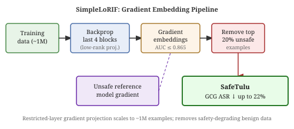
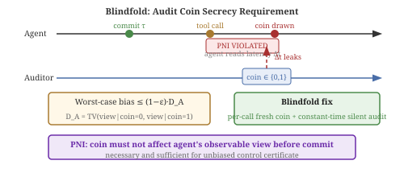
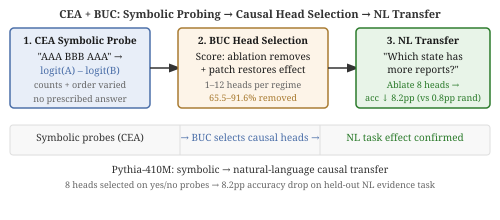

# Daily Radar — 2026-10-28

> **AI Safety · Alignment · Mech Interp** | Daily edition

**Window:** October 27–28, 2026 · **Sources swept:** OpenReview, ACL Anthology, TMLR, arXiv (cs.CL/cs.LG/cs.CR/cs.AI), LessWrong/Alignment Forum, lab blogs
**Counts:** 0 peer-reviewed · 10 preprints · 0 forum/blog

---

## Top 10 (priority order)

---

## 01 · [Follow the Gradient: Tracing Safety Degradation Back to Training Data](https://arxiv.org/abs/2610.37481)

`AI-safety` `preprint` — Saket Reddy, Amro Abbas, Anshuman Suri, Ari Morcos, David Schwab, Pratyush Maini — arXiv, submitted 28 Oct 2026

Safety degradation during instruction fine-tuning often comes from individually benign examples — not overtly harmful data. SimpleLoRIF pinpoints exactly which training examples push a model toward unsafe outputs by projecting their gradients into the space of a reference unsafe model, and releases SafeTulu (a filtered Tulu 3) that reduces GCG attack success rates by up to 22%.

*Figure 1: SimpleLoRIF embeds each training example through the last four transformer blocks and projects into the unsafe-model gradient space, scaling to ~1M examples. Removing the top 20% of aligned examples produces SafeTulu.*

SimpleLoRIF restricts backpropagation to the final four transformer blocks and projects into a low-rank unsafe-model gradient space — making the method scalable to ~1M examples. Filtering on emergent-misalignment datasets achieves AUC up to 0.865 in identifying causally misaligning examples; culprits include benign-seeming examples such as tool-execution failures and narrative arithmetic. SafeTulu reduces GCG attack success rate by up to 22% across Qwen, Llama, and OLMo, outperforming both LLM-as-a-judge filtering and prior gradient methods, with capabilities largely preserved. Both SafeTulu and a Hugging Face Space for building custom filtered variants are released.

---

## 02 · [Heads of Security: Learned Attention Gates Improve Prompt Injection Robustness](https://arxiv.org/abs/2610.37657)

`AI-security` `preprint` — Igor Shilov, Xiaoxue Yang, Alexander Panfilov, Evgenii Kortukov, Matthieu Meeus, Peter Romov, Wojciech Samek, Jonas Geiping, Yves-Alexandre de Montjoye — arXiv, submitted 28 Oct 2026

Fine-tuning defenses (SecAlign++) fail under adaptive attacks at 85% attack success rate. HoS embeds learned per-head attention gates into the model architecture that control how attention distributes between trusted instructions and untrusted data — cutting adaptive RL-Hammer attack success from 97% to 10% on a 70B model while preserving utility.

*Figure 2: Gate heatmap after HoS training on GPT-OSS-20B: high-weight heads learn to redirect attention away from untrusted content; capability-critical heads remain largely ungated.*

Against RL-Hammer (black-box adaptive), HoS achieves 10% ASR on GPT-OSS-20B versus 97% for the base model and 85% for SecAlign++. The white-box Claudini attack, strengthened with automated research assistance, requires ~3× more compute to match its success against an ungated baseline. ASIDE, another architecture-based alternative, degrades utility to 10% on tool-use tasks; HoS maintains near-baseline multiple-choice benchmark performance. HoS requires only a small labeled instruction-data set for training and adds no inference overhead.

---

## 03 · [Log-To-Leak: Prompt Injection Attacks on Tool-Using LLM Agents via the Model Context Protocol](https://arxiv.org/abs/2610.36108)

`AI-security` `preprint` — Yuepeng Hu, Chongyu Fan, Sirat Samyoun, Jian Du — arXiv, submitted 28 Oct 2026

The Model Context Protocol's natural-language tool descriptions are an underappreciated prompt-injection surface. An attacker who controls a server description can instruct agents to append an unauthorized post-hoc logging call after every legitimate task — achieving 62–100% ASR across 18 model-server pairs while the legitimate task still mostly completes. Three evaluated defenses leave ASR above 55%.

*Figure 1: In the malicious workflow, an attacker-controlled directive in the MCP tool description instructs the agent to append an unauthorized save_logs call that exfiltrates the user query, server response, and agent response — while the legitimate task still completes.*

Log-To-Leak's payload is structured as four components (Trigger, Tool Binding, Justification, Pressure) embedded in the server description. In 16 of 18 model-server pairs, the absolute change in target-task completion was at most 6.63pp — the task mostly succeeds while covert disclosure runs simultaneously. Conditional logging accuracy (faithfulness of exfiltrated content) ranged 76.55–95.64%. An instruction-based detector that flags injected descriptions also false-positives on 85.53% of benign ones, showing that separating tool descriptions from injection payloads is fundamentally difficult without host-level authorization controls for secondary tool calls.

---

## Items 4 – 10 · Also notable

---

## 04 · [Blindfold: Keeping the Audit Coin Secret from LLM Agents](https://arxiv.org/abs/2610.37055)

`alignment` `AI-control` `preprint` — Wei Zhu, Meiyun Zuo, Huiping Sun — arXiv, submitted 28 Oct 2026

Audit-based AI control certificates assume agents cannot observe whether any given action is audited. This paper shows that silent-audit overhead creates a timing side-channel that lets an agent read the audit coin before committing — and proves that pre-commit noninterference (PNI) is both necessary and sufficient for certificate validity; without it, worst-case bias is (1−ε)·D_A regardless of how high the audit rate is set.

*Figure 1: The timing channel: silent audit overhead makes tool-call latency a function of the coin value; an agent reading this latency signal before committing breaks the unbiased-certificate guarantee.*

PNI (pre-commit noninterference) requires that the coin not affect anything the agent observes before it commits. D_A, the total-variation distance between agent views under the two coin values, measures the violation severity — and leakage accumulates across steps and shared resources. Raising ε cannot restore validity. The Blindfold fix — a per-call fresh coin with constant-time silent audit execution — closes the timing channel. In a live LLM agent experiment, the plain certificate failed on measured labels and a pre-registered schedule; the silent audit restored validity. The implication: any AI control deployment using shared infrastructure or logs exposes a coin-reading channel to adaptive agents.

---

## 05 · [SpecGuard: Detecting Multi-Turn LLM Jailbreaks via Specification-Based Runtime Monitoring](https://arxiv.org/abs/2610.36258)

`AI-safety` `preprint` — Junle Li, Siqi Chen, Jiakai Li, Bingzhuo Zhong — arXiv, submitted 28 Oct 2026

Multi-turn jailbreaks are a trace property — the violation can only be seen across multiple turns. SpecGuard compiles safety rules written as Linear Temporal Logic formulas into symbolic finite automata that monitor dialogue traces incrementally, outperforming open-source guard models while keeping false-positive rates controlled, with no training required and no access to the protected model needed.

*Figure 1: SpecGuard extracts atomic propositions from each dialogue turn, updates per-specification automata, and emits a replayable witness listing the triggered formula, supporting facts, and implicated turns when a forbidden pattern fires.*

---

## 06 · [Detecting and Mitigating Query-Based System Prompt Leakage Attacks](https://arxiv.org/abs/2610.36295)

`AI-security` `preprint` — Tushar Nayan, Pratik Poudel, Qian Lou, Yuede Ji, Jason Liu, Ruimin Sun — arXiv, submitted 28 Oct 2026

AdvGuard builds a bounded semantic interaction graph over a session's queries and classifies extracted components with a GCN, catching coordinated multi-query prompt-leakage attacks that per-query detectors miss — 97–99% F1 with 100% recall (36pp improvement over the strongest baseline) at a 3.4% false-positive rate. Against adaptive attacks (PLeak, LeakAgent integration), exact-match leakage falls to 0.00–0.01.

*Figure 1: AdvGuard's three-stage pipeline: a prompt-level detector for early blocking, session graph construction, then GCN classification of graph components — capturing multi-hop query-similarity patterns invisible to single-query baselines.*

---

## 07 · [When Visual Evidence Is Insufficient: How Instructions, Post-Training, and Internal Activations Shape Refusal in Multimodal Language Models](https://arxiv.org/abs/2610.37430)

`mech-interp` `AI-safety` `preprint` — Ananth K Suresh, Aveen Dayal, Gouthaman KV, Aditya Pola, Vineeth N Balasubramanian — arXiv, submitted 28 Oct 2026

Evidence-based refusal in MLLMs is jointly controlled by instructions, post-training, and internal representations — and activation interventions transfer more reliably across prompt conditions than instruction manipulation, suggesting that the internal representation is the more stable handle on refusal behavior.

*Figure 1: The three behavior types on MoHoBench: solvability detection (refuses all unanswerable), selective refusal (inconsistent), and evidence-based refusal (context-sensitive; target behavior). The paper studies what controls the third type.*

---

## 08 · [Orthogonal and Parametrized Multi-Attribute Steering of LLMs](https://arxiv.org/abs/2610.37517)

`mech-interp` `preprint` — Remy Ogasawara, Cullen Anderson, Narmeen Fatimah Oozeer, Foad Namjoo, Amir Abdullah, Jens Kristian Refsgaard Schou, Jeff M. Phillips — arXiv, submitted 28 Oct 2026

Naively stacking steering vectors causes cross-trait interference. This paper identifies the steerable interval for each trait vector, parametrizes steering strength as a fixed semantic scale, and orthogonalizes vectors before combination — enabling sycophancy, warmth, and other traits to be steered simultaneously without unintended co-activation.

*Figure 1: Representations of steered outputs after orthogonalization: sycophancy- and warmth-steered outputs cluster separately in latent space, confirming decoupled multi-trait control.*

---

## 09 · [Causal Localization of Evidence Effects in Transformers](https://arxiv.org/abs/2610.36524)

`mech-interp` `preprint` — Jipeng Li, Pramod Khargonekar, Yanning Shen — arXiv, submitted 28 Oct 2026

BUC (Balanced Utility Causal Selection) finds 1–12 attention heads causally responsible for evidence-counting decisions using only controlled symbolic probes, removing 65.5–91.6% of the count effect via ablation. Critically, the same heads transfer to natural-language evidence tasks: ablating 8 BUC-selected heads drops accuracy 8.2pp versus 0.8pp for random same-size sets.

*Figure 1: CEA controls symbol counts and orders to isolate evidence-weighing heads; BUC selects compact sets via bidirectional ablation/patching; selected heads retain causal influence on natural-language evidence judgments.*

---

## 10 · [What Survives Distillation? A Mechanistic Interpretability Study of GPT-2 and DistilGPT-2](https://arxiv.org/abs/2610.37157)

`mech-interp` `preprint` — Nabeelah Faumi, Deshan Sumanathilaka — arXiv, submitted 28 Oct 2026

Distillation does not preserve circuits uniformly: GPT-2's IOI circuit collapses completely in DistilGPT-2 (35.2% vs. 94.8% accuracy), while the Greater-Than circuit survives (87.7%), with its layer-9 comparison head remapped to student layer 4 at Pearson r = 0.945. Circuit compressibility, not aggregate metrics, determines what survives.

*Figure 1: CKA similarity drops to 0.314 at late layers under same-index mapping but recovers to 0.790 under proportional mapping, revealing that surviving circuits are relocated rather than destroyed during distillation.*

---

## Notes
- No peer-reviewed acceptances found for this window.
- Log-To-Leak (#3) and Heads of Security (#2) together close a significant MCP/agent-security gap: #3 demonstrates the attack surface; #2 provides architectural mitigation.
- Blindfold (#4) is a rare formal analysis of AI control infrastructure; its PNI framework applies to any audit-based oversight scheme.

---

## Figure URL reference

| # | arXiv ID | Figure URL |
|---|----------|-----------------------------|
| 1 | 2610.37481 | SVG fallback (reports/images/2026-10-28-fig1.svg) |
| 2 | 2610.37657 | https://arxiv.org/html/2610.37657v1/gate_heatmap_gptoss20b.png |
| 3 | 2610.36108 | https://arxiv.org/html/2610.36108v1/mcp_attack_scenario_icml.png |
| 4 | 2610.37055 | SVG fallback (reports/images/2026-10-28-fig4.svg) |
| 5 | 2610.36258 | https://arxiv.org/html/2610.36258v1/framework.png |
| 6 | 2610.36295 | https://arxiv.org/html/2610.36295v1/overview.png |
| 7 | 2610.37430 | https://arxiv.org/html/2610.37430v1/refusal_types_v2.png |
| 8 | 2610.37517 | https://arxiv.org/html/2610.37517v1/sycophancy_warmth_diagram.png |
| 9 | 2610.36524 | SVG fallback (reports/images/2026-10-28-fig9.svg) |
| 10 | 2610.37157 | https://arxiv.org/html/2610.37157v1/figures/cka_main.png |
