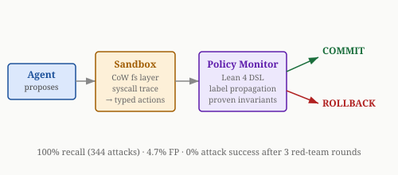
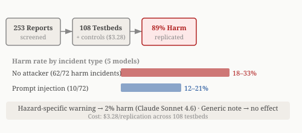
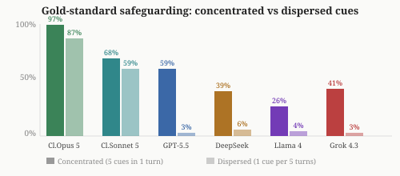
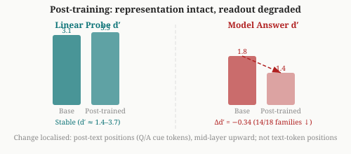
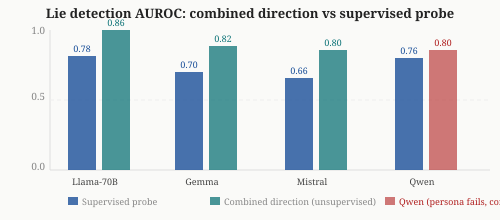
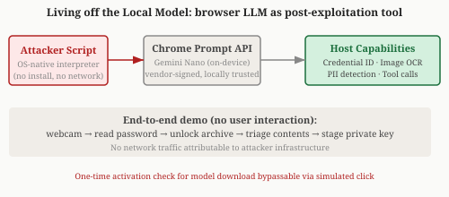

# Daily Radar — 2026-11-20

> **AI Safety · Alignment · Mech Interp** | Daily edition

**Window:** 2026-11-18 – 2026-11-20 · **Sources swept:** OpenReview, ACL Anthology, arXiv (cs.CL/cs.LG/cs.CR/cs.AI), lab blogs
**Counts:** 1 peer-reviewed · 9 preprints · 0 forum/blog

---

## Top 10 (priority order)

### 1. [**MATE: Mobile Agent Trustworthy Execution for Safe and Efficient Mobile Control**](https://arxiv.org/abs/2611.25526)
- **Authors / venue:** Minsuk Jang, Hee-Seon Kim, Hui-Cheol Yu, Changick Kim — EMNLP 2026 (accepted)
- **Why it ranks here:** Peer-reviewed agent safety paper with concrete blocking numbers at scale; addresses the under-studied mobile-agent threat surface with a deployable execution-layer design.
- **Technical summary:** MATE interposes an execution layer—the Runtime Guardrail (RG)—between a mobile agent's planned actions and the device, without modifying the underlying model. Each proposed UI action is encoded as a structured record (instruction, app, context, primitive, action fields) and evaluated against six sequential rails (jailbreak, topic, app allowlist, coordinate bounds, financial intent, action validity). Purchase-class actions are routed to user approval; all others are allowed or denied. A Predefined Task Routing (PTR) component handles recurring tasks through pre-verified routes with post-execution screen checks. On MobileSafetyBench with GPT-4o, high-risk action blocking rises from 29.7% to 97.0% (false-positive rate 4.1%); indirect prompt-injection blocking reaches 100% across both tested backbones. Task success on AndroidWorld is unchanged at 41.4%, with LLM-call overhead of only 4.2%.

*Figure 1: Radar chart of high-risk blocking rates per action category; MATE (outer ring) far exceeds the unguarded agent (inner ring) across all categories while keeping benign-task success intact.*

---

### 2. [**Tether: Verified Stateful Policy Engine for System-Level Monitoring of Agents**](https://arxiv.org/abs/2611.25599)
- **Authors / venue:** Meghana Aparna Sistla, Alaia Solko-Breslin, Somesh Jha, Aditya Kanade, Krishnamurthy Dj Dvijotham — arXiv preprint (cs.CR)
- **Why it ranks here:** First published agent-monitor to combine a copy-on-write execution sandbox, a formally verified Lean 4 policy DSL, and information-flow tracking; sets a new bar for provable security guarantees in agentic systems.
- **Technical summary:** Tether runs each proposed shell command in an ephemeral copy-on-write filesystem layer under system-call tracing, abstracting observed behavior into typed actions (copy, uploadNet, etc.). Policies are written in an embedded DSL inside Lean 4, allowing mechanical proof of invariants such as deny-overrides monotonicity and state preservation under denial. Labels propagate across multi-step executions, enabling information-flow control across arbitrarily long trajectories. On combined adversarial benchmarks (MonitoringBenchHonest + LinuxArena), Tether achieves 100% recall on 344 adversarial trajectories with an overall false-positive rate of 4.7% (74 / 1,590 benign trajectories). Claude Code's default Auto Mode by comparison achieves 91.6% recall at a 9.7% false-positive rate. Red-teaming reduced the attack success rate from 40% to 0% across three fix iterations; 22–28% of trajectories still require LLM-based content inspection, marking the boundary of purely formal monitoring.

*Figure 1: Tether's architecture — proposed actions enter an ephemeral sandbox; system calls are abstracted into typed actions; the Lean 4 policy monitor tracks security labels and either commits or rolls back the action.*

---

### 3. [**Replication of Agentic Security Events: Audit and Investigation (ROGUE-AI)**](https://arxiv.org/abs/2611.26553)
- **Authors / venue:** Mengxiao Wang, Mahbub Alam, Kalyan Nakka, Nitesh Saxena — arXiv preprint (cs.CR)
- **Why it ranks here:** Most systematic empirical audit of real-world LLM-agent incidents published to date; the finding that 86% of harm-causing incidents had no attacker directly challenges the prompt-injection-centric framing of agent safety.
- **Technical summary:** ROGUE-AI takes a public incident report, reconstructs an offline testbed, and runs a matched control that removes only the report's stated cause—allowing causal attribution at ~$3.28 per replication. Starting from 253 reports, the pipeline built 108 replications covering 96 incidents across 38 classes and reproduced the reported harm in 89% of them. Tested on five models (GPT-5.6-luna, GPT-5.6-sol, Claude Sonnet 4.6, Gemini 3.5 Flash, DeepSeek-V4-Flash), harm occurred in 18–33% of incident sessions versus ≤1% in controls. Of 72 incidents with real-world harm, 62 had no attacker—agents completed their task but missed an ordinary hazard such as a database shared with the live site. Attacker-free replications caused more harm than prompt-injection replications for all five models. A single warning inserted after each tool output that named the specific hazard and consequence reduced harm to 2% for Claude Sonnet 4.6; a length-matched note without that specificity left most harm intact.

*Figure 1: ROGUE-AI causal audit pipeline — each incident is replicated with and without the blamed cause; the harm-rate difference provides causal attribution across five frontier models.*

---

### 4. [**Evaluating safeguarding in multi-turn conversations with AI assistants**](https://arxiv.org/abs/2611.26009)
- **Authors / venue:** Charlotte Peart, Franziska Sofia Hafner, Luc Rocher — arXiv preprint (cs.CL)
- **Why it ranks here:** Provides the first controlled comparison of safeguarding under concentrated versus dispersed distress cues, revealing a severe safety gap that standard single-turn evaluations miss entirely.
- **Technical summary:** The authors scripted 21-turn everyday conversations (cooking, messaging a friend) in which five mental-health distress cues appear either all in turn 21 (concentrated) or one per five turns (dispersed). Three community mental health workers set gold-standard responses for nine scenarios spanning depression, psychosis, and domestic abuse. Over 7,400 conversations across six models, all models degraded substantially under dispersed cues: GPT-5.5 met the gold standard in 59% of concentrated conversations but only 3% of dispersed ones (Cliff's δ=0.75); Claude Opus 5 showed the smallest gap (97%→87%, δ=0.09) and Claude Sonnet 5 (68%→59%); Llama 4 Maverick dropped from 26% to 4%. LLM-judge scoring was validated at quadratic-weighted κ=0.93.

*Figure 1: Gold-standard safeguarding rates, concentrated (left) vs dispersed (right) conditions — only Claude Opus 5 stayed above 85% in both; all others collapsed to single digits when cues were spread across turns.*

---

### 5. [**Represented but misread: Post-training changes how language models read out what they represent**](https://arxiv.org/abs/2611.26584)
- **Authors / venue:** Jochen Laubrock — arXiv preprint (cs.CL)
- **Why it ranks here:** Provides mechanistic evidence that post-training modifies the linear readout of internal representations rather than the representations themselves—with direct implications for why alignment interventions generalise imperfectly and why probes and answers can disagree.
- **Technical summary:** The author uses signal-detection theory to compare linear-probe sensitivity with model-answer sensitivity for German human-vs-AI authorship discrimination across six open-weight model families and their post-trained counterparts. Probes decoded the signal near ceiling (median d′ 1.35–3.70 by corpus), but answers were often worse or inverted. Post-training lowered answer sensitivity on average (Δd′=−0.34 across six families; 14/18 comparisons decreased) while changing base-rate use. Activation-patching localised the checkpoint difference to positions after the text (question and answer-cue tokens) from mid-layer upward, not to text-token positions. In a training study, adding 1,994 labelled examples improved two corpora but inverted answers on a third, with the inverted direction predicted by a probe trained on the base model's out-of-domain representations. For the publicly reproducible negation case, post-training repaired base-model failures and the repair again sat at post-text positions.

*Figure 1: Signal-detection d′ for probes (high, stable) versus model answers (variable, often lower after post-training) across corpora and model families — the gap narrows only in the negation condition where post-training corrects base-model failures.*

---

### 6. [**Question, Then Affirm: Restoring Commitment Does Not Restore Refusal**](https://arxiv.org/abs/2611.25929)
- **Authors / venue:** Haoyang Xu, Qirui Wang, Liuwan Zhu — arXiv preprint (cs.CR)
- **Why it ranks here:** Identifies a novel structural bypass ("Deferred Semantic Commitment") that exploits refusal's sensitivity to surface commitment form rather than message semantics, with a 2.7× increase in image-generation attack success rate.
- **Technical summary:** The attack reformulates a harmful claim as a question followed by a confirmatory symbol (✓), causing the safety classifier to respond to the withdrawn commitment of the question while the downstream generator uses the restored commitment from the affirmation. On a 300-case evaluation against gpt-image-2, the question-affirmation form elicited images for 43.3% of cases versus 16.3% for direct statements (endorsing images: 41.3% vs 15.3%). Mechanistic analysis of an open-weight language model found that re-endorsement only partially reversed the refusal-related representational change caused by questioning, suggesting a mismatch between recovered semantic commitment and recovered refusal behavior.

*Figure 1: The Deferred Semantic Commitment attack: a direct harmful statement triggers refusal (top); rephrasing as a question followed by ✓ bypasses it and generates the endorsed image (bottom).*

---

### 7. [**The Geometry of Lies: Knowledge and Persona Directions for Detecting Deception in Large Language Models**](https://arxiv.org/abs/2611.26545)
- **Authors / venue:** Md. Abdullah Al Zami et al. — arXiv preprint (cs.AI)
- **Why it ranks here:** Advances mech-interp-for-safety by showing that combining unsupervised persona and knowledge directions yields deception probes that transfer across lie types better than supervised single-dataset probes, with no labels required at deployment.
- **Technical summary:** The paper extracts two unsupervised linear directions at a model's middle layers: a persona direction (from role-play activations) and a knowledge direction (from factual-denial activations). On Liars' Bench, the persona direction outperforms single-dataset probes on 3/4 models; the combined sum of both directions outperforms supervised probes on all four models (Llama-3.3-70B, Gemma, Mistral, Qwen). The knowledge direction separates lies from identical honest denials on 2/3 models. The approach requires no lie labels at test time and no downstream classifier, only the residual-stream geometry. Performance is uneven on Qwen (persona direction fails), indicating model-specific variation in how deceptive role-playing is encoded.

*Figure 1: AUROC on Liars' Bench for the combined persona+knowledge direction (blue) versus single-dataset supervised probes (red) across four model families — the unsupervised direction wins or ties on all four.*

---

### 8. [**Text-Aware, Vision-Blind: How Multimodal Image Editing Systems Handle Unsafe Inputs**](https://arxiv.org/abs/2611.26569)
- **Authors / venue:** Ziqing Yang, Yixin Wu, Michael Backes, Yang Zhang — arXiv preprint (cs.CR)
- **Why it ranks here:** Quantifies a systematic text-vision safety mismatch in deployed multimodal image editing APIs, showing that text-based guardrails are largely absent for the visual pathway despite high coverage for text.
- **Technical summary:** The authors introduce EditSafetyBench (5,940 image-instruction pairs, 11 risk categories, 3 edit intents) and test Gemini, GPT, and two Qwen variants. Text-unsafe prompts are refused at 87.1% (Gemini) and 81.6% (GPT), but image-unsafe inputs with neutral instructions are refused at only 24.2% (Gemini) and 22.4% (GPT). GPT allows 70.4% of edits involving unsafe political content; GPT-4o and Qwen Local have zero visual safety filters in several categories. Sexual content shows the strongest visual sensitivity. The gap narrows on Qwen Local because its text-based guardrails are weaker to begin with.

*Figure 1: Refusal rates across four systems — text-unsafe prompts (top) are blocked at 80–90%; image-unsafe inputs (bottom) pass through at 75–78%, revealing the vision-blind safety gap.*

---

### 9. [**ToolPulse: Side-Channel Eavesdropping on Tool-Using LLM Agents**](https://arxiv.org/abs/2611.25470)
- **Authors / venue:** Zihao Dan, Jinyu Zhang, Jinzhao Lian, Yun Chen, Shinan Liu — arXiv preprint (cs.CR)
- **Why it ranks here:** Demonstrates that confidentiality of an LLM agent's tool-use workflow can be broken with a cache side-channel even when the model runs on opaque vendor infrastructure, with >93% F1 across 11 models on a noisy multi-user server.
- **Technical summary:** When a commercial LLM drives tools running locally (e.g., shell commands, file I/O), those tools call shared system libraries whose memory accesses are observable via CPU cache side-channels. ToolPulse uses Flush+Reload (chosen over Prime+Probe for lower overhead and better accuracy) to monitor cache activity correlated with tool invocations. Three attacks are demonstrated: Tool Recovery (reconstructs the agent's tool-execution workflow; F1 ≥93% on 11 LLMs across Codex and Claude Code categories), Task Profiling (infers user intent from tool sequences), and Trigger Localization (flags sensitive calls such as encryption or model inference). All attacks maintain high accuracy on a server shared by ~20 concurrent users.

*Figure 1: ToolPulse attack architecture — cache monitoring of local tool calls (bottom) leaks the agent's workflow even when the LLM itself runs on opaque vendor infrastructure (top).*

---

### 10. [**Living off the Local Model: Abusing Browser-Embedded Language Models for Post-Exploitation**](https://arxiv.org/abs/2611.25086)
- **Authors / venue:** William Fleshman, Joseph Lucas — arXiv preprint (cs.CR)
- **Why it ranks here:** Identifies browser-embedded LLMs as a novel post-exploitation primitive—vendor-signed, locally trusted, invisible to network monitoring—with an end-to-end demonstration of autonomous credential exfiltration.
- **Technical summary:** Chrome's Gemini Nano (via the Prompt API) can be driven from the host using only OS-bundled interpreters; the one-time user-activation check for model download is bypassable with a simulated click. The paper measures the model's ability to identify credentials on a host, classify images, detect PII in email, and call custom tools through the API. In a simulated end-to-end operation, the model read a password from a webcam image, unlocked an encrypted archive, triaged its contents for sensitive data, and staged a private key for exfiltration—all without user interaction and without any network traffic attributable to attacker-controlled infrastructure.

*Figure 1: Attacker architecture — a script run via OS-native interpreter (shaded, no install) drives Gemini Nano through Chrome's Prompt API to perform host reconnaissance and exfiltration.*

---

## Notes
- Today's batch is heavily weighted toward agent security (entries 1–4, 9–10); alignment and mech-interp representation is thinner than average.
- Entry 5 (Represented but misread) is relevant to the weekly roundup for its implications on how post-training alignment interventions generalise.

---

## Figure URL reference

| # | arXiv ID | Figure URL |
|---|----------|------------|
| 1 | 2611.25526 | https://arxiv.org/html/2611.25526v1/radial.png |
| 2 | 2611.25599 | SVG fallback — no HTML figure URL found |
| 3 | 2611.26553 | SVG fallback — no HTML figure URL found |
| 4 | 2611.26009 | SVG fallback — no HTML figure URL found |
| 5 | 2611.26584 | SVG fallback — no HTML figure URL found |
| 6 | 2611.25929 | https://arxiv.org/html/2611.25929v1/phenomenon_user.png |
| 7 | 2611.26545 | SVG fallback — no HTML figure URL found |
| 8 | 2611.26569 | https://arxiv.org/html/2611.26569v1/fig_core_finding_v1.png |
| 9 | 2611.25470 | https://arxiv.org/html/2611.25470v1/Overview_v3.png |
| 10 | 2611.25086 | SVG fallback — no HTML figure URL found |
